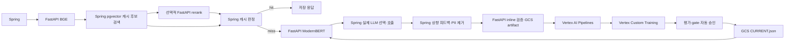

# LLM_Router-serving

Spring을 위한 BGE 임베딩, 선택적 캐시 재채점, ModernBERT 난이도 분류·명시적 후보 선택과 feedback 재학습 연동 서비스다.
기준일은 2026-09-25이며, 이 문서는 저장소 구현을 설명한다. 실제 배포 이미지·GCS 내용·클라우드 실행 완료 여부는 별도로 확인한다.

문서는 다음 세 개만 유지한다. 변경은 해당 내용을 소유하는 문서에 반영한다.

| 문서 | 단일 책임 |
| --- | --- |
| 이 README | 실행·설정·책임 경계·모델 전달 |
| [API 계약](docs/api-contract.md) | Spring HTTP, 개발자 API, 상태와 관측 해석 |
| [예시 안내](docs/examples/README.md) | 보존한 JSON·OpenAPI의 현행/과거 구분 |

학습 데이터·비교 실험·평가·feedback 및 캐시 실험은 [ML 최종 명세](../LLM_Router/docs/ml/README.md)가 소유한다.
과거 설정과 전환 단계는 [deprecated settings](../LLM_Router/docs/deprecated-settings.md)에만 남긴다.

## 책임과 처리 흐름



- Spring: 공개 서비스, pgvector, cache hit/miss 및 threshold, provider 모델 ID와 호출, 피드백 선택·PII 제거·전송 시점을 담당한다.
- FastAPI: 임베딩·재채점·라우팅 추론, inline feedback 검증·Parquet/manifest 생성·GCS 게시·Vertex 제출, 승인 모델 적재를 담당한다.
- ML pipeline: 공통 학습 코어, 전처리·학습·평가·gate·package·자동 승격을 담당한다. 코드가 KFP SDK로 작성되어 있어도 실행 대상은 managed Vertex AI Pipelines이며 GKE 운영을 전제하지 않는다.

현재 loader·자동 승격·continual retraining은 ModernBERT 전용이다. R0·R1은 기존 `/router/classify`의 요청과 `tier`, `model`, `confidence`, `modelVersion` 네 응답 필드를 그대로 사용하며, 명시적 정책이 있으면 양쪽 모두 그 정책으로 후보를 선택한다. [명시적 routing 정책](docs/api-contract.md#routing-policy-v2)은 R0/R1/R2 추론과 package 검증을 지원하지만, R1/R2의 online feedback·학습·승격 gate가 완성됐다는 뜻은 아니다. R3 또는 다른 backbone의 연구 checkpoint는 이 계약만으로 적재할 수 없다. 최초 학습과 실제 feedback 실험의 실행 범위는 [ML 명세](../LLM_Router/docs/ml/README.md#retraining)를 따른다.

## 로컬 실행

Python 3.11/3.12를 지원하며 기본은 3.12다.

```bash
python3.12 -m venv .venv
.venv/bin/pip install -e '.[dev]'
cp .env.example .env
```

[`.env.example`](.env.example)은 변수 목록을 확인하는 템플릿이다. 포함된 날짜·commit·버킷·v2 artifact·smoke gate는 현재 배포의 증거가 아니며 그대로 운영 설정으로 사용하지 않는다. 사용할 승인 package와 실행 계약에 맞춰 값을 채운다. 모델 소스 선택은 [Settings](src/llm_router_serving/config.py)의 검증을 따른다.

```bash
.venv/bin/uvicorn llm_router_serving.main:app --host 0.0.0.0 --port 8000
```

모델은 background로 적재한다. `/health`는 BGE와 router가 모두 준비되어야 200, 그 전에는 503이다. 선택적 reranker는 readiness에 영향을 주지 않는다. `/docs`와 `/openapi.json`은 실행 앱의 계약 확인 경로다.

`LLM_ROUTER_INTERNAL_API_TOKEN`을 설정하면 `/health`를 제외한 내부 업무 API에 bearer token이 필요하다. 미설정 시 애플리케이션 인증이 꺼지므로 로컬 개발 외에는 내부 네트워크 제한과 인증을 구성한다. 개발자 API는 별도 feature flag/token으로 보호한다.

## 모델 설정

| 대상 | 현행 기본값·동작 |
| --- | --- |
| BGE | `BAAI/bge-large-en-v1.5`, revision `d4aa6901d3a41ba39fb536a557fa166f842b0e09`; CLS pooling, L2 정규화, 1,024차원, prefix 없음, 512 token truncation |
| Router | R0·R1 신규 추론 목표 8,192; 명시적 길이 계약으로 실제 학습 길이와 분리 검증. 기존 v2 512 계약과 legacy v1 설정 호환 유지. [길이 계약](docs/api-contract.md#95-입력-정규화와-학습추론-길이-분리) |
| Reranker | 기본 비활성; 이미지에 `cross-encoder/quora-distilroberta-base` revision `f62e7a4b20b97195c2868e53ec59126df5eac743` 포함, 최대 길이 512, 기본 후보 16개 |
| 장치 | `LLM_ROUTER_MODEL_DEVICE=auto`: CUDA 사용 가능 시 CUDA, 아니면 CPU |

`modelVersion`은 설정/패키지에서 반환하는 식별자다. embedding 출력에 revision이 자동으로 붙는다고 가정하지 않는다. 임베딩·reranker가 바뀌면 version 식별자와 Spring의 cache namespace/threshold를 함께 바꾼다.

Reranker 사용은 `LLM_ROUTER_RERANK_MODEL_ID=/opt/models/quora-distilroberta-base`로 명시한다. 캐시 실험에서 threshold와 잘못된 재사용 비율을 검증하고 Spring의 실패→cache miss 처리를 연결한 배포에서 활성화한다.

## 컨테이너와 모델 전달

[Dockerfile](Dockerfile)은 BGE와 reranker를 build 시 다운로드하고 runtime은 Hugging Face offline mode로 실행한다. 모델 다운로드는 image build 환경에만 필요하다. UID/GID는 10001이다.

```bash
docker build -t llm-router-serving:local .
```

배포는 이미지 digest와 환경 설정을 기록하고 `/app/var`를 UID 10001이 쓸 수 있는 영속 volume에 연결한다. service-account JSON key는 이미지에 넣지 않고 실행 환경의 Google identity/ADC를 사용한다. GPU 설정에는 호환 NVIDIA runtime이 필요하다.

| 설정 | 역할 |
| --- | --- |
| `LLM_ROUTER_ROUTER_MODEL_CURRENT_POINTER_URI` | 배포가 추적할 `CURRENT.json`; 생략 시 publish root에서 유도 |
| `LLM_ROUTER_ROUTER_MODEL_PACKAGE_URI`, `LLM_ROUTER_ROUTER_MODEL_VERSION` | 고정 승인 package·초기 재학습 anchor 식별 |
| `LLM_ROUTER_ROUTER_MODEL_PATH` | 로컬 개발 모델 디렉터리 |
| `LLM_ROUTER_ROUTER_MODEL_CACHE_DIR` | 다운로드 cache, 기본 `var/models` |
| `LLM_ROUTER_ROUTER_MODEL_REQUIRE_APPROVED` | 기본 `true`, 미승인 package 거부 |
| `LLM_ROUTER_ROUTER_MODEL_AUTO_RELOAD`, `LLM_ROUTER_ROUTER_MODEL_POLL_INTERVAL_SECONDS` | watcher 활성·기본 60초 간격 |

승인 pipeline이 package와 `CURRENT.json`을 게시하면 watcher가 새 package를 별도로 다운로드한다. `model_manifest.json`의 schema, label 순서, version, 파일별 SHA-256 및 pointer의 manifest SHA-256을 확인하고 로딩이 끝난 뒤 classifier 참조를 교체한다. 실패하면 직전 모델을 유지하고, 진행 중 요청도 이미 얻은 classifier로 완료한다. 실제 반영은 `/router/model/current`와 상태 API의 `activation`으로 확인한다.

## 재학습 운영 설정

변수의 전체 목록과 기본값은 [Settings](src/llm_router_serving/config.py), 설정 초안은 [`.env.example`](.env.example), 학습 정책과 실험 차이는 [ML 명세](../LLM_Router/docs/ml/README.md#retraining)가 기준이다.

| 설정 묶음 | 필수 확인 |
| --- | --- |
| `VERTEX_*` | project/location, GCS의 컴파일된 pipeline template, pipeline root, pipeline/training service account와 output 경로 |
| `BASE_TRAINING_DATASET_URI`, `FEEDBACK_PREPROCESSING_CONFIG_URI`, `TRAINING_CONFIG_URI` | 서로 같은 데이터·전처리·학습 계약인지 확인 |
| `ROUTERARENA_DATASET_URI`, `EVALUATION_CONFIG_URI`, `BASELINE_METRICS_URI`, `GATE_RULES_URI` | 현재 코드의 평가 입력 변수명; 연구용 독립 gate와 기존 RouterArena 경로의 차이는 ML 실행 차이표 참조 |
| `PACKAGE_METADATA_URI`, `MODEL_PUBLISH_ROOT_URI`, `MODEL_CODE_COMMIT` | package 계보, 자동 승격 root, 실제 학습 이미지의 source commit |
| `RETRAINING_DERIVED_DATA_ROOT_URI` | immutable cycle/replay feedback 저장 |
| `RETRAINING_OBSERVABILITY_ROOT_URI` | run별 단계 집계·heartbeat·결과 저장 |
| `RETRAINING_CONTROL_ROOT_URI` | `validatedUniqueBatch`의 digest ledger용 |
| `RETRAINING_DB_PATH`, `ALLOWED_GCS_BUCKETS` | 영속 SQLite 경로·허용 bucket |

표의 모든 변수명 앞에는 `LLM_ROUTER_`를 붙인다. dataset/config URI는 template의 기본값을 덮어쓰므로 계약 전환 시 dataset, config, metadata, IR과 image를 함께 고정한다. 현재 v2 경로를 최신 실험 데이터로 자동 간주하지 않는다. 설정 검증은 존재·호환성 검사가 아니므로 실제 object, IAM, checksum과 승인 baseline/gate를 실행 전에 확인한다. 느슨한 smoke gate와 빈 baseline은 운영 평가 기준이 아니다.

FastAPI runtime identity에는 해당 prefix의 object 읽기·생성·필요한 정리 권한, Vertex 제출 권한, 사용할 pipeline service account에 대한 실행 권한이 필요하다. pipeline/training identity의 데이터·모델·관측 artifact 권한은 별도로 설정한다. Spring에는 재학습용 GCS/Vertex 권한이 필요 없다.

SQLite에는 batch fingerprint·run ID·version lineage와 policy가 저장된다. 한 FastAPI replica와 영속 volume을 전제하며, 다중 replica는 공유 transactional store/lease 도입 후 적용한다. 제출 중 process가 종료되어 run ID가 없는 lease는 기본 900초 이후 다음 제출에서 Vertex의 결정적 job ID와 대조해 채택 또는 해제한다.

GCS는 dataset·config·model·관측값을 보관하고, Artifact Registry는 container image를 보관한다. 소스 압축 업로드는 선택적 백업이며 서버를 실행하지 않는다. 필요한 경우 commit으로 추적되는 source만 별도 version 경로에 보관하고 secret·`.env`·credential·`var`·가상환경·model cache를 제외한다. 업로드 전 목록을 확인하고 내려받은 archive의 SHA-256을 대조한다. 실행 SQLite 백업은 source archive와 분리한다.

## 검증과 구현 확인

```bash
.venv/bin/ruff check .
.venv/bin/ruff format --check .
.venv/bin/pytest
```

기본 테스트는 fake inference/GCS/Vertex adapter를 사용한다. 실제 모델 확인은 `scripts/smoke_bge.py`, reranker 점수 비교는 `scripts/verify_reranker_parity.py`의 실행 조건을 확인한 뒤 수행한다. 실제 cloud run과 승인 모델 변경은 별도 실행 기록으로 남긴다.

HTTP·상태 처리의 현재 한계는 [API 계약의 구현 범위](docs/api-contract.md#implementation)에서 확인한다. 이 문서 정리는 코드 변경이나 클라우드 배포 완료를 의미하지 않는다.
